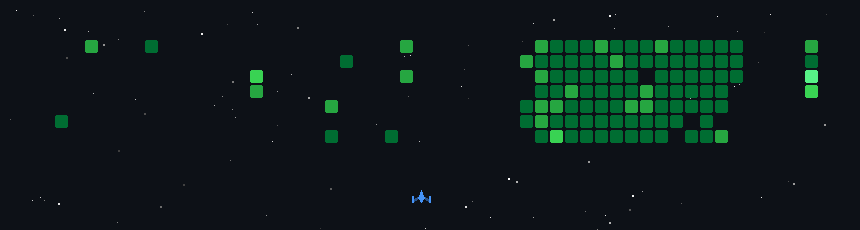

I'm a B.Tech CSE student at **UPES, Dehradun**, building across full-stack development, cloud infrastructure, and applied AI. I like turning ideas into working, deployable software, from Terraform-driven infrastructure to deep learning on satellite imagery.

 

## Currently

- 🧩 Building **Diagram Studio**, an AI-powered diagramming and documentation workspace
- 🔭 Working on **Cloud Craver**, a multi-cloud infrastructure template generator
- 🛰️ Researching methane plume detection with **IIRS / ISRO**
- 📚 Sharpening **Data Structures &amp; Algorithms**
- ☁️ Going deeper into **AWS** and **DevOps**
- 🤝 Open to collaborating on impactful projects

 

## Featured Projects

<table>
  <tr>
    <td colspan="2" valign="top">
      <h3>🧩 Diagram Studio</h3>
      
An AI-powered technical design and documentation workspace for engineers, product managers and technical teams, inspired by <a href="https://www.eraser.io/">Eraser.io</a> and built from the ground up as a reverse-engineering exercise.

      <ul>
        <li><b>Infinite canvas</b> for system architectures, cloud infrastructure (AWS, Azure, GCP), flowcharts, sequence diagrams and ER diagrams</li>
        <li><b>Diagram-as-code</b>: write text that renders into diagrams, so changes are easy to version-control on GitHub</li>
        <li><b>AI diagram generation</b> from natural language prompts, code files, Terraform scripts and documents (PDF, Word, Markdown)</li>
        <li><b>Note editor</b>: Markdown specs and decision records with live diagrams embedded from the canvas</li>
        <li><b>Integrations</b>: git repositories, MCP servers and IDE agent workflows to keep diagrams in sync with code</li>
      </ul>
      
   

      <a href="https://github.com/Navneet14-cmd/diagram-studio">View repository →</a>
    </td>
  </tr>
  <tr>
    <td width="50%" valign="top">
      <h3>🌩️ Cloud Craver</h3>
      
Generates and validates infrastructure templates for <b>AWS, Azure and GCP</b> using Terraform, so teams can go from idea to a valid, reviewable config quickly.

      
   

      <a href="https://github.com/Navneet14-cmd/OSoC-25-Cloud-Craver">View repository →</a>
    </td>
    <td width="50%" valign="top">
      <h3>🛰️ Methane Plume Detection</h3>
      
Research project with <b>IIRS / ISRO</b> applying deep learning to remote sensing imagery to detect methane plumes.

      
  

      <a href="https://github.com/Navneet14-cmd/RWMethaneP">View repository →</a>
    </td>
  </tr>
  <tr>
    <td colspan="2" valign="top">
      <h3>🛡️ NapGuard</h3>
      
A lightweight, zero-dependency Python library for validating environment variables. It collects every configuration problem and fails once with a single clear report, so you fix everything in one pass instead of one crash at a time.

      <ul>
        <li><b>Typed getters</b>: <code>require</code>, <code>get_int</code>, <code>get_bool</code>, <code>get_url</code> and <code>get</code> with defaults</li>
        <li><b>All errors at once</b>: <code>validate()</code> raises one <code>ConfigError</code> with a formatted report of every problem</li>
        <li><b>Missing vs empty</b> are reported as distinct problems</li>
        <li><b>Secret-safe</b>: raw values never appear in errors, reports or reprs</li>
        <li><b>Test-friendly</b>: inject a plain dict instead of the real environment</li>
      </ul>
      
  

      <a href="https://github.com/Navneet14-cmd/NapGuard">View repository →</a>
    </td>
  </tr>
</table>

 

## Tech Stack

**Languages**&#160;&#160;

**Frontend**&#160;&#160;

**Backend &amp; Data**&#160;&#160;

**Cloud &amp; Tools**&#160;&#160;

 

## GitHub Stats

  
  

 

## Contribution Game

  

 

## Let's Connect

  
  
  
  

